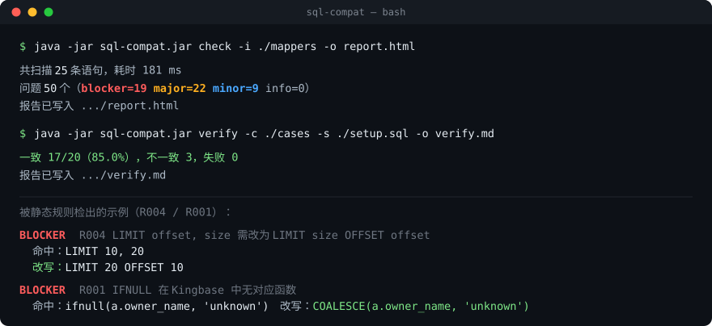

# sql-compat

> 检查 MyBatis Mapper XML / SQL 在 **MySQL → Kingbase(PostgreSQL 系)** 迁移中的方言兼容性问题，输出可直接落地的改写建议。

[](https://github.com/TheStateOfIntoxication/sql-compat/actions/workflows/ci.yml)
[](LICENSE)
[](https://adoptium.net/)
[](docs/rules.md)

---

## 为什么做这个

做过 MySQL → 国产数据库的双栈交付：同一套业务代码要维护**两套初始化脚本 + 两套 Mapper XML**，每次改动都要逐条对照方言差异，漏一条就是上线事故。

这个工具把"人工对照"变成"跑一次命令"：解析 Mapper XML 和 SQL，逐条匹配方言规则，输出带**严重级别**和**改写建议**的报告。

工具分两层：

| 层 | 命令 | 解决的问题 | 依赖 |
|---|---|---|---|
| **静态检查** | `check` | 语法级方言差异（`IFNULL`、`LIMIT off,size`、`AUTO_INCREMENT`…） | 只要 JDK |
| **运行时对比** | `verify` | 两边都能跑、但**结果不一样**（整数除法、`\|\|` 语义、NULL 排序） | 两个活库 |

第二层才是贵的：静态规则找的是"报错"，实际线上事故大多来自"不报错但数不对"。

```bash
# 静态检查：扫描一个目录，生成 HTML 报告
java -jar sql-compat.jar check -i ./src/main/resources/mappers -o report.html

# 双库对比：同一套用例在 MySQL 和 PostgreSQL 各跑一遍
java -jar sql-compat.jar verify -c ./cases -s ./setup.sql -o verify.md
```

```
scanned 25 statements in 178 ms
issues: 50  (blocker=19 major=22 minor=9 info=0)

17/20 consistent (85.0%), 3 different, 0 error
```



---

## 快速开始

**要求**：JDK 25+（`maven.compiler.release=25`），Maven 3.9+

```bash
git clone https://github.com/TheStateOfIntoxication/sql-compat.git
cd sql-compat
mvn -q verify                                   # 构建 + 跑测试
mvn -q -pl sql-compat-cli -am package           # 打可执行 jar

java -jar sql-compat-cli/target/sql-compat.jar check \
     -i sql-compat-samples/src/main/resources \
     -o report.html
```

### 命令行参数

| 参数 | 说明 |
|---|---|
| `-i, --input` | Mapper XML 文件、`.sql` 文件，或目录（递归扫描） |
| `-o, --output` | 报告输出路径，默认 `sql-compat-report.<ext>` |
| `-f, --format` | `html`（默认）或 `md` |
| `--fail-on` | `BLOCKER` / `MAJOR` / `MINOR` / `INFO`，达到该级别时进程退出码为 1 —— **用于 CI 卡口** |
| `--fix` | 自动执行**等价**改写（R001 / R004 / R016），结果写到 `--fix-out`，不改源文件 |
| `--fix-all` | 连需要人工确认的改写一起执行（R002 / R009 / R013）。**改前先读 [docs/manual-decisions.md](docs/manual-decisions.md)** |
| `--fix-out` | 改写输出目录，默认 `./sql-compat-fixed` |
| `--in-place` | 直接在源目录改写。除特殊场景外不建议 |
| `--ignore` | 忽略指定规则编号，逗号分隔（如 `R011` 或 `PARSE`），把报告收敛到关心的范围 |

### 自动改写

```bash
# 等价改写：只动语义不变的那部分
java -jar sql-compat.jar check -i ./mappers --fix -o report.html

# 连需确认的改写一起上
java -jar sql-compat.jar check -i ./mappers --fix-all --fix-out ./fixed -o report.html
```

实际效果（本项目 samples，25 条语句）：

| 模式 | 生效规则 | 问题数 |
|---|---|---|
| 不改写 | —— | 50 |
| `--fix` | R001 R004 R016 | **46** |
| `--fix-all` | R001 R002 R004 R009 R013 R016 | **23** |

剩下的 23 个**不是工具没做完，而是需要人拍板** —— 逐条列在
[docs/manual-decisions.md](docs/manual-decisions.md)（`LIMIT` 的 DML、`INSERT IGNORE` 的语义、
upsert 的冲突目标、自增序列起点、触发器副作用……）。

**三条硬规则**
1. 不改源文件，默认输出到 `--fix-out`
2. 改写必须**幂等**：对已改写的结果再跑一次不得再变（有单测守着，不收敛的改写比不改写更危险）
3. 改完**必须重新扫描**并报告问题数下降 —— 否则改写没有验收标准

---

## 规则清单

| ID | 规则 | MySQL 写法 | 目标方言写法 | 级别 |
|---|---|---|---|---|
| R001 | IFNULL 无对应函数 | `IFNULL(a, b)` | `COALESCE(a, b)` | BLOCKER | ✅ 等价 |
| R002 | 日期格式化 | `DATE_FORMAT(col, '%Y-%m-%d')` | `TO_CHAR(col, 'YYYY-MM-DD')` | BLOCKER | ⚠️ 需确认（格式串映射） |
| R003 | DML 不支持 LIMIT | `DELETE/UPDATE ... LIMIT n` | `WHERE ctid IN (SELECT ctid ... LIMIT n)` | BLOCKER |
| R004 | 分页语法 | `LIMIT off, size` | `LIMIT size OFFSET off` | MAJOR |
| R004 | 分页语法 | `LIMIT off, size` | `LIMIT size OFFSET off`（参数位置互换） | BLOCKER | ✅ 等价 |
| R005 | 批量插入忽略冲突 | `INSERT IGNORE` | `ON CONFLICT DO NOTHING` | BLOCKER |
| R006 | Upsert | `ON DUPLICATE KEY UPDATE` + `VALUES(col)` | `ON CONFLICT (cols) DO UPDATE SET col = EXCLUDED.col` | BLOCKER |
| R007 | 自增主键 | `AUTO_INCREMENT` | `GENERATED BY DEFAULT AS IDENTITY` / `SEQUENCE` | BLOCKER |
| R008 | 字符串聚合 | `GROUP_CONCAT(...)` | `STRING_AGG(..., ',')` | BLOCKER |
| R009 | 标识符引用 | 反引号 `` `col` `` | 双引号 `"col"` 或无引号 | MAJOR | ⚠️ 需确认（大小写折叠） |
| R010 | **分页无排序** | `LIMIT n` 但无 `ORDER BY` | 行序未定义，两库返回不同记录 | MINOR |
| R011 | MyBatis `<foreach>` | 动态拼 `IN (...)` / 批量 VALUES | 空集合 → `IN ()`；参数上限 65535 | MINOR |
| R012 | 正则匹配 | `REGEXP` / `RLIKE` | `~` / `~*` | MAJOR |
| R013 | JSON 取值 | `JSON_EXTRACT(c, '$.k')` | `c ->> 'k'`（文本）/ `c -> 'k'`（jsonb） | MAJOR | ⚠️ 需确认（`->` 还是 `->>`） |
| R014 | 布尔语义 | `TINYINT(1)` | `BOOLEAN`（**不要**映射成 SMALLINT） | MINOR |
| R015 | 字段自动更新时间 | `DATETIME ... ON UPDATE CURRENT_TIMESTAMP` | 触发器或应用层维护 | MAJOR |
| R016 | NULL 安全等于 | `a <=> b` | `a IS NOT DISTINCT FROM b` | BLOCKER | ✅ 等价（含 XML 转义形式） |
| R017 | DESC 排序 + 分页 | `ORDER BY col DESC ... LIMIT` | NULL 位置不同，需显式 `NULLS FIRST/LAST` | MINOR |
| R018 | 索引前缀长度 | `KEY idx (col(10))` | `CREATE INDEX ... (left(col, 10))` | MAJOR |
| R019 | 覆盖式插入 | `REPLACE INTO` | `INSERT ... ON CONFLICT DO UPDATE` | MAJOR |
| R020 | 日期函数 | `DATE_ADD` / `DATE_SUB` / `STR_TO_DATE` / `UNIX_TIMESTAMP` | `+ INTERVAL '1 day'` / `TO_DATE` / `EXTRACT(EPOCH ...)` | BLOCKER |

> ✅ **20 条规则全部实现**，共 79 个单测（含 6 条规则的改写正确性与幂等性）。每条规则至少有「能检出」+「不误报」两个用例 ——
> 误报比漏报更致命：一条爱喊狼来了的规则，一周之内就会被关掉。
>
> 有几条规则的语义在 v0.1 定稿时做过调整（R010 / R016 / R017 / R020），原因都记在
> [`docs/rules.md`](docs/rules.md) 里：原本设想的方向在纯文本层面无法可靠检测，
> 与其做成一个永远不触发或永远误报的规则，不如换成一个真实存在、可检测的问题。

---

## 架构

```
Mapper XML / .sql
        │
        ▼
 MyBatisXmlParser ──────► SqlStatement (id, sql, 位置)
        │                        │
        │                        ▼
        │                 SqlParserFacade ──► AST（失败则降级为纯文本规则）
        │                        │
        └────────────┬───────────┘
                     ▼
              RuleRegistry ──► DialectRule#check(RuleContext)
                     │              （内置 + ServiceLoader 自动发现）
                     ▼
                Report (问题清单 + 分级统计)
                     │
                     ▼
       MarkdownReportRenderer / HtmlReportRenderer
```

### 运行时对比（第二层）

```
cases/*.sql  ──► CaseLoader ──► SqlCase(id, sql, ordered)
                                        │
        setup.sql（两边各跑一遍）          │
                    │                   ▼
                    │        DualDbComparator
                    │           ├─ DbProbe(mysql)    ──► 预热 2 次 + 测量 5 次，取中位数
                    │           └─ DbProbe(postgres) ──┘
                    │                   │
                    │                   ▼
                    │            ValueNormalizer（两侧值归一）
                    │                   │
                    └────────► ResultSetDiffer（无序则排序后比，有序则按位比）
                                        │
                                        ▼
                        ComparisonReport（一致率 + 差异明细 + 耗时）
```

**关键的三个判断**

1. **值归一化是核心**，否则几乎每条用例都会"不一致"：MySQL 的 `TINYINT(1)` 返回 `1`，PostgreSQL 的 `boolean` 返回 `true`；`DECIMAL` 的标度也不同。`ValueNormalizer` 把它们收窄到同一个字符串。
2. **无序查询先排序再比**。没有 `ORDER BY` 时行序本来就是未定义的，不排序等于把"允许的差异"当成 bug。
3. **故意不归一的两件事**：整数除法（MySQL `1/2`=0.5，PG=0）和 `||` 语义（MySQL 当作逻辑或）。这些是真实陷阱，必须报出来。

**几条设计取舍**
- **不用 Spring Boot**：CLI 工具启动不需要容器，冷启动 200ms 比 3s 值钱
- **解析失败不算错误**：解析不了的语句记 `parseError`，纯文本规则照跑——比整体失败有用
- **规则用 ServiceLoader 自动发现**：第三方加规则不用改核心代码- **报告自包含**：HTML 内嵌 CSS、无外链、无 JS，双击就能看

---

## 在 CI 里使用

```yaml
- name: sql-compat gate
  run: |
    java -jar sql-compat.jar check \
      -i src/main/resources/mappers \
      -f md -o sql-compat.md \
      --fail-on BLOCKER
```
有 BLOCKER 时构建失败，报告作为 artifact 上传。

### 双库一致性卡口

```yaml
- name: consistency gate
  run: |
    java -jar sql-compat.jar verify \
      -c ./cases -s ./setup.sql \
      -o verify.md --fail-under 95
```
一致率低于 95% 时构建失败。库连接串走环境变量（`SQLCOMPAT_MYSQL_URL` / `SQLCOMPAT_PG_URL`），
**不要写进命令行** —— 进程参数会进 shell 历史和构建日志。

本项目的 CI 就是这么跑的：runner 自带 Docker，用 `services:` 起 `mysql:8.0` + `postgres:16`，
开发者本机不需要装任何数据库。参考 [.github/workflows/ci.yml](.github/workflows/ci.yml)。

---

## 如何贡献一条规则

1. 在 `sql-compat-core/.../rule/builtin/` 新建 `XxxRule.java`，实现 `DialectRule`
2. 在 `META-INF/services/com.sqlcompat.core.rule.DialectRule` 里登记（外部规则）
3. 加单测：**一个能检出、一个不误报**
4. 在 README 规则表里登记 ID + 级别 + 改写建议

```java
public final class InsertIgnoreRule implements DialectRule {
    public String id() { return "R005"; }
    public Severity defaultSeverity() { return Severity.BLOCKER; }
    public List<Issue> check(RuleContext ctx) { /* ... */ }
}
```

---

## 局限与路线图

**局限（如实写）**
- 工具只能改**语法形状**，改不了**业务语义**。哪些必须人工拍板，逐条列在 [docs/manual-decisions.md](docs/manual-decisions.md)：
  6 条完全不能自动改（`LIMIT` 删除、`INSERT IGNORE`、upsert、`AUTO_INCREMENT`、`REPLACE INTO`、`ON UPDATE`），
  12 条能改但残留一个决策点（如 `REGEXP` 的大小写敏感默认值相反、`GROUP_CONCAT` 的 1024 截断在 PG 不存在）
- Kingbase 用 **PostgreSQL 16** 做近似验证：Kingbase 基于 PG，方言高度一致，但**不是** 1:1 实测
- 分页/批量/DML 类规则靠 AST + 正则，MyBatis 动态 SQL 采用"展平"策略，极端嵌套场景可能漏判
- 规则只覆盖高频场景，不做完整方言矩阵
- 解析器的能力边界、动态标签展平的已知缺口、各规则的误报取舍，逐条记在 [docs/known-limitations.md](docs/known-limitations.md)
  （真实项目实测：146 条语句中 29 条解析失败，修正 `<where>` / `<set>` 展平后降到 18 条）
- 一致性对比中的耗时是**同机同数据的指示性对比**，不是 benchmark；两个引擎的优化器与默认存储都不同
- `FLOAT` / `REAL` 按 10 位有效数字比较：避开二进制表示噪声，代价是更小的真实差异看不出来
- 用例集需自带可移植的建表与造数脚本，暂不支持从生产库采样

**路线图**
- [x] v0.1 解析器 + 规则引擎 + HTML/Markdown 报告
- [x] v0.2 规则补至 20 条（R001–R020），55 个单测
- [x] v0.3 双库（MySQL 8.0 + PG 16）一致性回归 + 耗时对比，CI 内置
- [x] v0.4 `--fix` 自动改写：6 条可改规则（3 等价 + 3 需确认），幂等 + 改后重扫验收
- [ ] v0.5 用例生成：从 Mapper XML 反向生成一致性用例，减少手写成本
- [ ] v1.0 Maven 插件 / IDE 插件

---

## License

[MIT](LICENSE)
